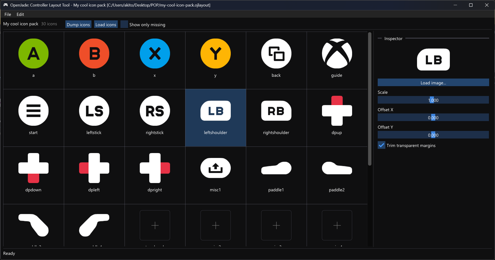

# Controller Layout Maker

## What is it

A Windows editor for OpenJade controller icon packs (`.ojlayout`).

## How to use

1. Run `controller-layout-maker.exe` and create or open a layout.
2. Select buttons, load their images, and save with **Ctrl+S**.
3. Choose **File > Install into OpenJade...** and select `openjade.exe`.
4. Restart OpenJade and select the pack in **Settings > Controls > Gamepad > Control Icons**.

To create a `.jtmod` package, choose **File > Export as JTMod...**.
